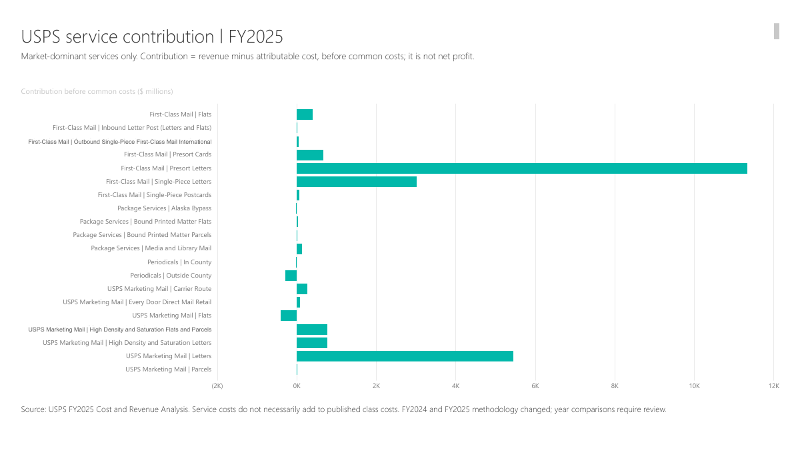
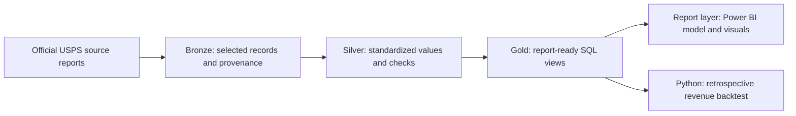

# USPS service economics: financial analysis and forecasting

An AI-assisted analytics project that traces public USPS financial reports into a local SQL Server data pipeline and a five-page Power BI report. It examines revenue, attributable costs and **contribution before common costs**, then compares simple revenue-forecasting methods on a small historical sample.



> **Portfolio snapshot:** The image and [five-page PDF](assets/usps-portfolio-snapshot.pdf) are static, adapted exports from an earlier published report layout. The [Power BI project source](powerbi/) contains the later locally reviewed design. The online report is private and is not offered as a public interactive demo.

## Business question

Which reported services warrant a closer financial review, and how have selected services changed over time? The analysis identifies **questions to investigate**, not causal explanations or fully allocated service profitability.

For FY2025, USPS Marketing Mail Flats reported approximately **$1,129.6 million in revenue** and **$1,534.3 million in attributable costs**, a contribution of **−$404.7 million before common costs**. That gap is a reason to investigate volume, pricing, service mix and cost drivers; these reports alone do not establish the cause or tell us the service's net profit.

For the same service, reported nominal revenue fell from about **$1,649.4 million in FY2018** to **$1,129.6 million in FY2025**, an indexed change of roughly **−31.5%**. Inflation, reporting changes and differences in source precision limit the comparison.

## Architecture



Bronze, silver and gold refer to the implemented SQL Server schemas. The **report layer** is the downstream semantic model and report, not a fourth standard medallion layer. The source extracts cover **88 selected rows**, not the full postal business: 64 rows from FY2024–FY2025 and 24 older rows for four services. The 2025 detail view contains **20 services**; the historical view contains **32 service-year observations**.

The local pipeline was tested for repeatable loading, reconciliation and rollback on changed inputs. A separate scheduled watcher checks for official source documents, archives them and indexes provenance. **It does not automatically approve, extract or load new financial figures.** An on-premises gateway connects the private online report to local SQL Server; manual visual refresh worked, and a query roughly 30 minutes after page selection provided strong but not conclusive evidence of the configured automatic refresh cycle.

## Forecasting: compare before extrapolating

The [Python exercise](forecast/) compares a last-year baseline with a linear trend using rolling, earlier-only training windows. For Marketing Mail Flats, validation on FY2022–FY2024 produced WAPE of approximately **4.56%** for the baseline and **11.39%** for the trend. The baseline was then evaluated against FY2025, which had already been seen in earlier project work and is **not a fresh independent holdout**.

The FY2026 figure is a **retrospective illustration**, not a current forecast. Eight annual observations and three validation years are insufficient to establish operational reliability. A decision-grade forecast would require current comparable data, business drivers, stakeholder input, uncertainty and ongoing monitoring.

Run the standalone example and its checks with Python 3.10 or newer:

```bash
python forecast/forecast.py
python -m unittest discover -s forecast -v
```

The included CSV makes this portion runnable without SQL Server, Power BI or third-party Python packages. A GitHub Actions workflow is configured to run the tests on Python 3.10 and 3.13.

## Explore this repository

| Folder | Contents |
| --- | --- |
| [`forecast/`](forecast/) | Reproducible Python backtest, data extract and tests |
| [`sql/`](sql/) | Selected SQL pipeline and reporting logic, with setup limitations |
| [`powerbi/`](powerbi/) | Reviewed Power BI project and semantic-model source |
| [`assets/`](assets/) | Static portfolio preview and complete five-page PDF |
| [`docs/data-notes.md`](docs/data-notes.md) | Definitions, source links, limitations and validation |

## Guardrails

- **Contribution is not net profit.** It subtracts attributable costs but excludes common costs.
- USPS publishes independently calculated group costs; individual services and published totals can overlap. Do not sum them without validating the accounting relationship.
- Historical values are nominal estimates; source precision, service definitions and costing methods can differ across years. Do not infer a business cause from the trend alone.
- The model has three DirectQuery tables without relationships. The project is an analytical exercise, not an official USPS product or investment recommendation.
- Codex assisted with analysis, code, documentation and validation; cleanup decisions were reviewed before application. No claimed time savings or business results are invented.

## Sources

Source figures come from USPS's public Cost and Revenue Analysis reports and related regulatory filings. Original reports are linked, not redistributed: [FY2025 report](https://about.usps.com/what/financials/cost-revenue-analysis-reports/fy2025.pdf), [revised FY2024 report](https://about.usps.com/what/financials/cost-revenue-analysis-reports/fy2024.pdf), and [Postal Regulatory Commission filing](https://prc.arkcase.com/api/prc-dockets/filing/downloadFile?fileId=250695&inline=false). See [data notes](docs/data-notes.md) and the per-row forecast extract for provenance. USPS retains its own rights to its source materials.
